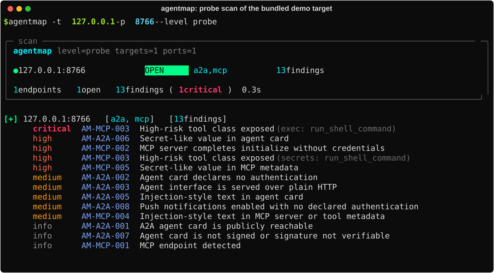

# Agentmap

Black-box discovery, fingerprinting and risk assessment for A2A agents and MCP
servers on a network you are authorized to test.



*A `--level probe` scan of the deliberately vulnerable demo server in `demo/test-target/`, running on loopback.*

## What it finds

- A2A agent cards at `/.well-known/agent-card.json` (and the legacy
  `/.well-known/agent.json` path some deployments still use).
- MCP servers on Streamable HTTP and legacy HTTP+SSE transports, their
  `initialize` handshake, and (at `--level probe`) their tool, resource and
  prompt inventory.
- Exposed MCP developer tooling (for example an MCP Inspector UI left
  reachable on the network).

## Install

```sh
python3 -m venv .venv && . .venv/bin/activate
python -m pip install .
agentmap --help
```

For development (editable install with test dependencies):

```sh
python -m pip install -e '.[dev]'
```

## Usage

```sh
agentmap -t 10.0.0.0/24                      # passive discovery, agent-default ports
agentmap -t host.example -p 80,443,8000-8010
agentmap -f targets.txt -o runs --level probe
agentmap -t host.example --level active --acknowledge "I am authorized to test these targets"
agentmap diff runs/old runs/new
agentmap rules list
```

| Flag | Purpose |
|---|---|
| `-t, --targets` | comma-separated hosts, `host:port`, URLs, or CIDR |
| `-f, --target-file` | one target per line, `#` comments |
| `-p, --ports` | a preset name (`agent-default`, `web`) or `80,443,8000-8010` |
| `--protocols` | restrict to `a2a` and/or `mcp` (default: both) |
| `--level` | `passive` (default) \| `probe` \| `active` |
| `--acknowledge` | required at `--level active`; the exact phrase agentmap prints when refusing |
| `--rate` | requests/second cap, applied to every stage: TCP connect, TLS/scheme detection, and HTTP requests alike |
| `--time-limit` | bound total scan time; a timed-out run records `Coverage.stopped` |
| `--resolve` | `host:port:ip`, for split-horizon DNS, repeatable |
| `--auth-file` | a mode-0600 JSON file of header name to value; never pass credentials on argv |
| `--exclude` | host or CIDR to remove from scope, repeatable |
| `--yes` | required above 1,024 estimated hosts |
| `-o, --outdir` | where the run directory is created (default `runs/`) |
| `--resume` | continue an interrupted run directory |
| `--format` | any of `json,md,html` (default: all three) |
| `--fail-on` | exit 1 if a finding at or above this severity exists |
| `--plain` | no ANSI; one line per endpoint |

## Levels

| Level | Sends | Gate |
|---|---|---|
| `passive` | GET requests to discovery documents only | none |
| `probe` | + MCP `initialize`, `tools/list`, `resources/list`, `prompts/list` | `--level probe` |
| `active` | + Origin/protocol-version/bearer-token checks against access control | `--level active` + `--acknowledge` |

agentmap never calls `tools/call`, `resources/read`, `prompts/get`,
`message/send`, or any `tasks/*` method, at any level. See `docs/RULES.md` for
every finding agentmap can produce, and `docs/ADDING-A-PROTOCOL.md` to extend
it to another protocol.

## Authorization

**Use this only against systems you are explicitly authorized to test.**
`probe` level enumerates a server's full tool/resource/prompt surface
unauthenticated if the server allows it; `active` level sends requests
specifically designed to test whether access control works. Read
`docs/LIVE-PREFLIGHT.md` before running either against anything you do not
own.

What agentmap enforces:

- **A default-deny scope allowlist.** Every request, including one a protocol
  plugin's own redirect-following or OAuth-metadata-following logic wants to
  make, is checked against the scope before any socket opens. A URL that
  fails the check is recorded as refused, never silently dropped and never
  silently followed.
- **A typed acknowledgement at `--level active`**, recorded in `run.json`
  with a timestamp, so you can show a client afterwards exactly what was
  agreed to and when it ran.
- **No state-changing protocol operation, ever**, regardless of level (see
  `tests/test_invariants.py`).
- **`--rate` and `--time-limit`** bound request rate and total runtime.

What it cannot enforce, and you must confirm yourself:

- **Scope is per hostname; a shared IP can answer for other services.**
- **Egress.** A client's source-IP allowlist means scanning from the wrong
  network produces a clean-looking, empty result.
- **Authorization has a scope *and* a window.** `run.json` records when a run
  happened; confirm that falls inside the agreed period.

## Output

A run directory under `-o`/`runs/` contains `run.json` (manifest), masked
`results.jsonl` and `findings.jsonl`, `evidence/` (mode 0700; raw unmasked
bodies, mode 0600 each; never share this directory), `findings.json`
(versioned schema), `report.md` and `report.html`.

## Requirements

Python 3.10+. `httpx`, `Jinja2`, `PyYAML`, `rich`, installed from package
metadata. No external scanner binaries are required; agentmap talks HTTP
directly. It can also read output from `nmap` (`-oX`), ProjectDiscovery
`httpx` (`-json`) and `naabu` via `--from-nmap`, `--from-httpx` and
`--from-naabu`.

## Tests

```sh
pytest -q
```

No test touches the network; fake servers run on loopback ephemeral ports.

## Known limits

- Poisoning and tool-risk heuristics are pattern-based and will have false
  positives and false negatives; they are reported as indicators, never as
  confirmed findings.
- `agentmap/data/advisories.yaml` is curated by hand and only as current as
  its last review.
- Card/server signature verification is not implemented in 0.1.0;
  unsigned and unverifiably-signed cards are both reported as informational.

## License

Apache License 2.0. See [LICENSE](LICENSE).
